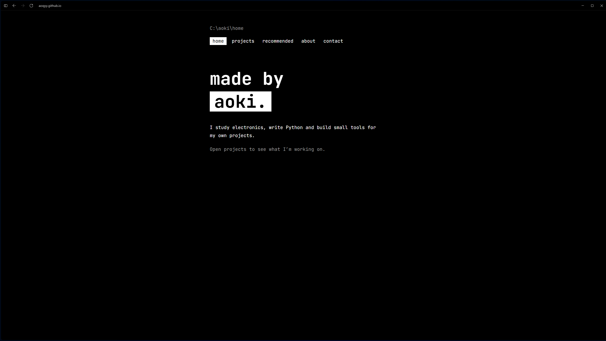

# aoqyy.github.io

My personal site: projects, things I recommend, and a bit about me.
Terminal-style, minimal, no frameworks.

**[→ aoqyy.github.io](https://aoqyy.github.io)**

## Features

- **terminal look**: JetBrains Mono, black / white, path header `C:\aoki\<tab>`, typing intro
- **dark mode** and fluid typography that scales with the screen
- **tabs**: home, projects, recommended, about, contact
- **recommended**: apps, guides and repos with live GitHub stars (cached for 1 hour)
- **content in one file**: everything on the site lives in `data.js`
- **no build step**: plain HTML, CSS and JavaScript, hosted on GitHub Pages

## How it works

All content is stored in `data.js`, and the page renders it on load.
To update the site I use a local admin page with live preview. It edits and saves `data.js`, then I commit and push.
The admin page is local only and is not part of this repository.

## Structure
