<p align="center">
  
</p>

<p align="center">
  <a href="https://aoqyy.github.io"></a>
  <a href="LICENSE"></a>
  
  
  
  <a href="https://github.com/aoqyy/aoqyy.github.io/commits/main"></a>
</p>

<p align="center">
  <a href="#features">Features</a> ·
  <a href="#how-it-works">How it works</a> ·
  <a href="#privacy">Privacy</a> ·
  <a href="#use-it-for-your-own-site">Use it</a> ·
  <a href="#roadmap">Roadmap</a>
</p>

My personal site: projects, things I recommend, and a bit about me.
Terminal-style and minimal: one HTML file, one stylesheet, all content in one data file. No frameworks, no build step.

**[→ aoqyy.github.io](https://aoqyy.github.io)**


## Features

- **terminal look**: JetBrains Mono, black / white, a path header like `C:\aoki\projects` that follows the open tab
- **typing intro**: `made by aoki.` types itself once per visit, skipped if you prefer reduced motion
- **dark mode** that follows your system, and fluid typography that scales with the screen
- **tabs** without page reloads: `home`, `projects`, `recommended`, `about`, `contact`, each with its own url (`#projects`)
- **recommended**: apps, guides and repos, filter by type, live GitHub stars for repo links (cached for an hour)
- **content in one file**: everything on the site lives in `data.js`
- **safe links**: only `http(s)` and `mailto` links are rendered, anything else becomes plain text

## How it works

All content is stored in `data.js` as one object, and the page renders it on load:

```js
window.SITE = {
  home: { lead: "...", note: "..." },
  projects: [
    { title: "motd", url: "https://github.com/aoqyy/motd", desc: "..." },
  ],
  recommended: [{ type: "repo", title: "...", url: "...", desc: "..." }],
  about: {
    text: "...",
    rows: [{ tag: "stack", text: "Python, Git, VS Code" }],
  },
  contact: [{ tag: "git", label: "aoqyy", url: "https://github.com/aoqyy" }],
};
```

To update the site I use a local admin page with a live preview: it edits `data.js` and shows the result next to the editor, then I commit and push.
The admin page only works on a local copy and is not part of this repository.

## Privacy

No analytics, no cookies, no trackers. The page talks to these services and nothing else:

- [GitHub API](https://docs.github.com/en/rest): star counts for repos in `recommended`
- [Google Fonts](https://fonts.google.com): loads the JetBrains Mono font

Star counts are cached in your browser's `localStorage` for an hour, because GitHub allows 60 requests per hour without a token.
`sessionStorage` remembers that the intro has already played.

## Use it for your own site

The code is MIT, so feel free to take it:

1. Fork the repo and rename it to `<your-username>.github.io`
2. Replace the content in `data.js` with your own, and the name in `index.html`
3. Turn on GitHub Pages: Settings → Pages → branch `main`, folder `/ (root)`

No build step, no dependencies: you can also just open `index.html` locally.

## Structure

```
index.html   layout, tabs, rendering, typing intro
style.css    all styles, light / dark theme
data.js      all site content
docs/        banner and screenshot for this readme
```

## Roadmap

- [x] tabs with their own urls
- [x] typing intro
- [x] GitHub stars in recommended
- [x] filter by type in recommended
- [ ] more projects
- [ ] profile README in the same style

## Credits

Font [JetBrains Mono](https://www.jetbrains.com/lp/mono/) · stars by the [GitHub API](https://docs.github.com/en/rest) · badges by [shields.io](https://shields.io)

## License

Code: [MIT](LICENSE). Content (texts in `data.js`, screenshots): © 2026 aoki, all rights reserved.
